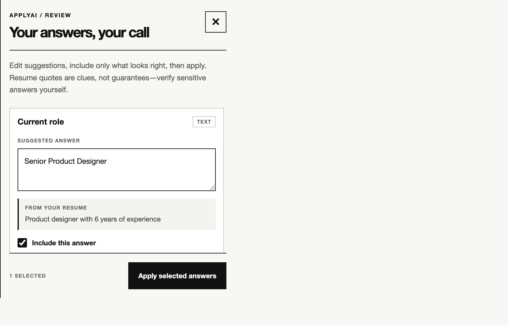
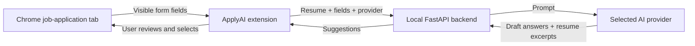

# ApplyAI

**A job-application copilot that drafts answers from your experience—and lets you review every answer before it touches the form.**

ApplyAI is a Chrome extension with a small FastAPI backend. Choose an AI provider, add your resume, open an application, and review editable suggestions with resume excerpts before applying them.

> ApplyAI is an assistive tool, not an application bot. Check every answer—especially salary, eligibility, and other personal or legal information—before applying or submitting.

## Screenshots

| Profile setup | Review before applying |
| --- | --- |
|  |  |

The review image uses a fictional job form and sample suggestions to demonstrate the interface; it is not a live application or provider response.

## What it does

- Saves a resume profile and provider choice in Chrome local extension storage.
- Adds ApplyAI to the current tab only after you click the extension icon.
- Detects visible, editable form fields, labels, and select/radio/checkbox choices.
- Generates suggestions from the form context and resume.
- Shows editable suggestions and exact resume excerpts when available.
- Starts suggestions without a matching resume excerpt unchecked.
- Applies only the answers you select, then reports fields it could not fill.
- Generates DOCX content for supported file-upload fields.

## How it works



The extension sends requests to `http://127.0.0.1:8000/api/autofill`. The backend calls the selected provider through LiteLLM. Answers are previewed in the extension before selected values are applied to the page.

## Requirements

- Python 3.9 or newer
- Google Chrome or a Chromium-based browser with unpacked extension support
- An API key for at least one supported AI provider

## Quick start

### 1. Install backend dependencies

From the repository root:

```bash
cd backend
python3 -m venv .venv
source .venv/bin/activate
pip install -r requirements.txt
```

On Windows PowerShell, activate the environment with:

```powershell
.venv\Scripts\Activate.ps1
```

### 2. Configure an AI provider

Create `backend/.env` from the example:

```bash
cp .env.example .env
```

Add the key for the provider you plan to use:

```dotenv
OPENAI_API_KEY=your_openai_key
# Or use one of these instead:
# ANTHROPIC_API_KEY=your_anthropic_key
# GEMINI_API_KEY=your_gemini_key
```

Do not commit `.env` or share API keys. See [`.env.example`](backend/.env.example) for all supported environment variables.

### 3. Start the backend

Run from the `backend` directory with the virtual environment active:

```bash
uvicorn main:app --reload --host 127.0.0.1 --port 8000
```

Keep this terminal open while using the extension. The API documentation is available at [http://127.0.0.1:8000/docs](http://127.0.0.1:8000/docs).

### 4. Load the extension

1. Open `chrome://extensions`.
2. Turn on **Developer mode**.
3. Choose **Load unpacked** and select this repository's `extension` folder.
4. Open the ApplyAI extension options.
5. Select a provider, paste your resume, and save your profile.

### 5. Use ApplyAI

1. Open a job application page.
2. Click the ApplyAI extension icon to enable ApplyAI on that tab.
3. Click the **AI** button on the page.
4. Review and edit the generated suggestions. Select only the answers you want.
5. Click **Apply selected answers**, then check the form before submitting it yourself.

## Supported providers

The provider selector maps to these LiteLLM models in [`backend/llm.py`](backend/llm.py):

| Settings choice | Model |
| --- | --- |
| OpenAI | `gpt-4o-mini` |
| Anthropic | `claude-3-haiku-20240307` |
| Google | `gemini/gemini-3.8-flash` |

Model availability and account access depend on the provider. If a model is unavailable to your account, check the model name and provider access configured for this project.

## Privacy and data handling

- The resume and provider selection are stored in `chrome.storage.local` on the browser profile. Extension local storage is not encrypted by ApplyAI.
- When you request suggestions, the resume and detected field context are sent to your local backend and then to the selected AI provider.
- ApplyAI does not currently include a user account, hosted backend, application-history database, or resume deletion/sync service.
- The local backend listens on `127.0.0.1` by default. Cross-origin access is restricted unless you explicitly configure `CORS_ORIGINS`.
- The extension requests access to the active tab only when you click its toolbar icon; it does not automatically inject into every site.
- Read the selected provider's data-retention and privacy policies before sending personal information.

## Development

### Run tests

From the `backend` directory with the project virtual environment active:

```bash
python -m unittest discover -s tests -v
```

The tests cover request validation, answer/evidence parsing, generated DOCX content, and provider error handling. They mock provider calls and do not require a live AI API key.

### Main project paths

```text
backend/
  main.py          FastAPI endpoint and provider error handling
  models.py        Request and response validation
  llm.py           Prompting, LiteLLM calls, and DOCX generation
  tests/           Backend unit tests
extension/
  manifest.json    Chrome extension permissions and entry points
  background.js    Toolbar activation and backend requests
  content.js       Field extraction, review panel, and approved form filling
  options.html     Profile settings page
  options.css      Settings page styles
  options.js       Profile persistence and settings interactions
docs/screenshots/  README screenshots
```

## Troubleshooting

### The extension says the backend is unavailable

- Confirm Uvicorn is running in the backend virtual environment.
- Confirm it is listening at `127.0.0.1:8000`.
- Reload ApplyAI from `chrome://extensions` after changing extension files.

### The API reports that a provider is temporarily unavailable

The API returns `503 Service Unavailable` for provider outages and includes a `Retry-After` hint. Wait and retry, or select another configured provider. If the issue persists, verify the API key, account access, model availability, and provider status.

### Rate limit or quota errors

Wait before retrying, then check the selected provider's quota, billing, and rate limits.

### Some fields were not filled

ApplyAI skips fields it cannot safely match or no longer finds on the page. It also ignores unsupported/unchecked suggestions until you select them. Check custom controls manually and review all populated values before submitting.

## Contributing

Issues and pull requests are welcome. For changes to the autofill flow, include tests for parsing, validation, or the affected form-control behavior where practical. Never include real resumes, API keys, or other personal application data in tests, screenshots, or issue reports.
